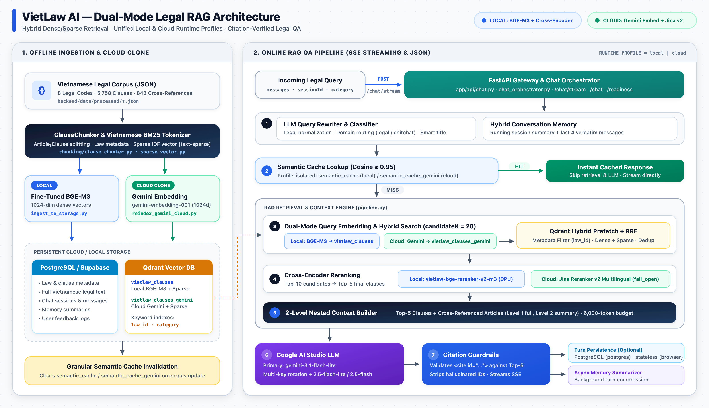

# VietLaw AI — Vietnam Legal QA System

A Retrieval-Augmented Generation (**RAG**) assistant for searching and answering questions about Vietnamese legislation with inline article/clause citations, hybrid dense/sparse vector search, cross-encoder reranking, and a unified **Local / Cloud** runtime switch.

> **Legal Disclaimer:** This project is built for academic research and coursework (*Introduction to Machine Learning*), not as a substitute for licensed legal advice. Always verify critical legal decisions against official Vietnamese statutory texts or a qualified attorney.



## Team Members

| Student ID | Name |
|---|---|
| 23120283 | Pham Quoc Khanh |
| 23120301 | Pham Thanh Nam |
| 23120318 | Truong Quang Phat |
| 23120329 | Chau Huynh Phuc (Team Lead) |
| 23120334 | Huynh Tan Phuoc |

---

## Table of Contents

- [Key Capabilities](#key-capabilities)
- [Architecture Overview](#architecture-overview)
- [Project Structure](#project-structure)
- [Quick Start](#quick-start)
- [Cloud Mode & Vercel Deployment](#cloud-mode--vercel-deployment)
- [Environment Configuration](#environment-configuration)
- [Legal Corpus](#legal-corpus)
- [Testing & Verification](#testing--verification)
- [Additional Documentation](#additional-documentation)
- [Known Limitations](#known-limitations)

---

## Key Capabilities

- **One-Line Local / Cloud Mode Switch (`RUNTIME_PROFILE`)**:
  - `local`: Runs offline fine-tuned `vietlaw-bge-m3` embeddings + fine-tuned `vietlaw-bge-reranker-v2-m3` cross-encoder against Qdrant collection `vietlaw_clauses`.
  - `cloud` (alias `serverless`): Zero local ML weights; runs Google Gemini Embeddings (`models/gemini-embedding-001`, 1024d) + Jina AI Cross-Encoder Reranker (`jina-reranker-v2-base-multilingual`, `fail_open`) against isolated Qdrant collection `vietlaw_clauses_gemini`.
- **Hybrid Qdrant Retrieval + 2-Level Nested Cross-Reference Context**:
  - Combines 1024-dim dense semantic search with Vietnamese BM25 sparse vectors (`text-sparse`) via Qdrant Reciprocal Rank Fusion (RRF), pre-filtered by `law_id`/`category`.
  - Automatically expands legal cross-references (Level 1 full clause text, Level 2 summary) within a 6,000-token context budget.
- **Server-Authoritative Google AI Studio LLM & Citation Guardrails**:
  - Uses `gemini-3.1-flash-lite` with automatic multi-key rotation and model fallback (`gemini-2.5-flash-lite`, `gemini-2.5-flash`).
  - Deterministically validates `<cite id="...">` markers against retrieved sources, stripping hallucinated IDs before persisting or finalizing SSE responses.
- **Privacy-Safe Chat Persistence & Hybrid Memory**:
  - `CHAT_STORAGE_MODE=browser` (default on Vercel) keeps conversations isolated in each user's browser `localStorage`.
  - `CHAT_STORAGE_MODE=postgres` (local/trusted demos) persists sessions, messages, feedback, and async background memory summaries in PostgreSQL/Supabase.
- **Responsive Mobile, Tablet & Desktop UI**:
  - Dynamic viewport (`h-dvh`) with safe-area support, collapsible drawer on `< 1024px` with edge-locked swipe gestures, iOS zoom-safe inputs, horizontally scrollable Markdown tables, and Portal bottom-sheet citation/feedback modals in Light & Dark modes.

---

## Architecture Overview

See [`overview.png`](overview.png) (editable vector source: [`docs/overview.svg`](docs/overview.svg)).

1. **Query Understanding**: `LLMRewriter` normalizes the user's legal query, classifies `legal` vs. `chitchat`, splits complex queries into sub-queries, and generates a concise session title.
2. **Semantic Cache**: Queries Qdrant (`semantic_cache` in `local`, `semantic_cache_gemini` in `cloud`; cosine threshold `0.95`) for instant hits.
3. **Hybrid Retrieval**: Embeds the query using the active profile's provider and executes Qdrant hybrid prefetch (dense + Vietnamese BM25 sparse) with RRF (`RETRIEVER_CANDIDATE_K=20`), filtered by selected legal code when specified.
4. **Cross-Encoder Reranking**: Reranks up to 10 candidates down to `RETRIEVER_K=5` final clauses using the local fine-tuned Cross-Encoder (`local`) or Jina Reranker v2 (`cloud`).
5. **Context Assembly & Generation**: `NestedContextBuilder` expands referenced clauses within `CONTEXT_TOKEN_BUDGET=6000`, streams grounded Vietnamese answers from Google AI Studio, validates citations, and asynchronously updates the rolling conversation summary.

---

## Project Structure

```text
Vietnam-Legal-QA-System/
├── .env.example                       # Minimal local/cloud environment template
├── docker-compose.yml                 # Local Postgres, Qdrant, backend, frontend, ingest
├── vercel.json                        # Vercel Services config (Next.js + FastAPI + bindings)
├── overview.png                       # High-resolution pipeline diagram
├── docs/                              # Architecture, deployment, local model & eval guides
│   ├── overview.svg                   # Editable vector source for overview.png
│   ├── deployment-runtime-profiles.md
│   ├── local_model_integration.md
│   ├── legal_answer_quality_evaluation.md
│   └── pipeline_latency_measurement.md
├── backend/                           # FastAPI + Python RAG service
│   ├── main.py                        # Entrypoint exporting FastAPI `app`
│   ├── requirements.txt               # Lightweight production/cloud dependencies
│   ├── requirements-local.txt         # Local ML extras (torch, transformers, sentence-transformers)
│   ├── app/
│   │   ├── main.py                    # App factory, /health, /readiness, /_/backend prefix middleware
│   │   ├── config.py                  # Unified RUNTIME_PROFILE=local|cloud configuration
│   │   ├── models.py                  # Pydantic request/response schemas
│   │   ├── api/                       # chat.py, documents.py, feedback.py
│   │   └── services/
│   │       ├── chat_orchestrator.py   # Shared sync/SSE RAG turn orchestration
│   │       ├── pipeline.py            # Retrieval, reranking & context assembly orchestrator
│   │       ├── llm.py                 # Google AI Studio multi-key/model fallback client
│   │       ├── storage.py             # PostgreSQL + Qdrant schema & persistence
│   │       ├── semantic_cache.py      # Profile-isolated Qdrant semantic cache
│   │       ├── memory_manager.py      # Async rolling conversation summarizer
│   │       ├── answer_validation.py   # Deterministic citation verification & sanitization
│   │       ├── embedding/             # hf_endpoint.py (local/api), gemini.py, ollama.py
│   │       ├── reranking/             # cross_encoder.py, jina_reranker.py, embedding_similarity.py
│   │       ├── search/                # qdrant_search.py, faiss_search.py
│   │       ├── rewriting/             # llm_rewriter.py
│   │       ├── chunking/              # clause_chunker.py
│   │       └── context_builder/       # nested_builder.py
│   ├── data/processed/                # Processed JSON legal codes (5,758 clauses)
│   ├── scripts/                       # ingest_to_storage.py, reindex_gemini_cloud.py, eval & audit tools
│   ├── evaluation/                    # Ragas evaluation pipeline
│   └── tests/                         # Pytest unit & integration suite
├── frontend/                          # Next.js 15 + React 19 + Tailwind CSS v4
│   ├── app/                           # App Router layout, page, /api/chat & /api/feedback proxies
│   ├── components/chat/               # ChatInterface, Sidebar, ChatMessage, ChatEmptyState, ProviderSelector
│   ├── hooks/                         # use-chat-sessions, use-click-outside, use-mobile
│   ├── lib/                           # constants, types, utils
│   └── scripts/                       # Automated UX, model, settings & storage verification scripts
└── fine-tuning/                       # Bi-encoder (BGE-M3) & cross-encoder fine-tuning notebooks
```

---

## Quick Start

### Prerequisites

- **Python 3.11+** and **Node.js 18+**
- **Google AI Studio API Key** (`GOOGLE_API_KEYS`)
- **PostgreSQL** (local Docker or Supabase) and **Qdrant** (local Docker or Qdrant Cloud)
- For `RUNTIME_PROFILE=local`: fine-tuned weights placed under `models/` (see [`docs/local_model_integration.md`](docs/local_model_integration.md))
- For `RUNTIME_PROFILE=cloud`: **Jina AI API Key** (`JINA_API_KEY`) and populated `vietlaw_clauses_gemini` collection

### 1. Configure Environment

```bash
git clone https://github.com/cyhapun/Vietnam-Legal-QA-System.git
cd Vietnam-Legal-QA-System
cp .env.example .env
```

Edit `.env` to set `RUNTIME_PROFILE` (`local` or `cloud`), your API keys, and database credentials.

### 2. Run Backend (Terminal 1)

```bash
cd backend
python3 -m venv .venv
source .venv/bin/activate   # Windows: .venv\Scripts\activate

python -m pip install -r requirements.txt
# Only required for RUNTIME_PROFILE=local:
python -m pip install -r requirements-local.txt

PYTHONPATH=. uvicorn app.main:app --host 0.0.0.0 --port 8000 --workers 1
```

### 3. Run Frontend (Terminal 2)

```bash
cd frontend
npm install
npm run dev
```

Open `http://localhost:3000`. Verify backend readiness at `http://localhost:8000/readiness`.

### 4. Run with Docker Compose

```bash
docker compose up --build -d

# Run one-time ingestion against local Postgres + Qdrant (optional)
docker compose --profile tools run --rm ingest
```

---

## Cloud Mode & Vercel Deployment

### Cloning Vectors to `vietlaw_clauses_gemini`

`local` and `cloud` use separate Qdrant collections so switching modes never corrupts existing BGE-M3 vectors. Populate `vietlaw_clauses_gemini` safely (read-only on `vietlaw_clauses`, automatically skips already-indexed IDs so runs can resume across keys or days):

```bash
cd backend
PYTHONPATH=. .venv/bin/python scripts/reindex_gemini_cloud.py --dry-run
PYTHONPATH=. .venv/bin/python scripts/reindex_gemini_cloud.py
```

### Deploying to Vercel

`vercel.json` configures Vercel Services (`frontend` on `/` + `backend` on `/_/backend` with automatic `BACKEND_URL` service bindings, `RUNTIME_PROFILE=cloud`, and `CHAT_STORAGE_MODE=browser`). Set only these **5 Environment Variables** in Vercel Project Settings:

| Variable | Description |
|---|---|
| `GOOGLE_API_KEYS` | One or more comma-separated Google AI Studio API keys |
| `JINA_API_KEY` | Jina AI API key for `jina-reranker-v2-base-multilingual` |
| `POSTGRES_DSN` | Supabase/PostgreSQL URI (use Supabase IPv4 Session/Transaction Pooler on Vercel) |
| `QDRANT_URL` | Qdrant Cloud cluster URL (`https://...:6333`) |
| `QDRANT_API_KEY` | Qdrant Cloud API key |

See [`docs/deployment-runtime-profiles.md`](docs/deployment-runtime-profiles.md) for detailed deployment and rollback guidance.

---

## Environment Configuration

Changing a single line in `.env` (`RUNTIME_PROFILE=local` vs. `RUNTIME_PROFILE=cloud`) automatically switches all coupled defaults:

| Setting | `RUNTIME_PROFILE=local` | `RUNTIME_PROFILE=cloud` *(alias `serverless`)* |
|---|---|---|
| Embedding | Local `vietlaw-bge-m3-finetuned` (1024d) | Google Gemini `models/gemini-embedding-001` (1024d) |
| Reranking | Local `vietlaw-bge-reranker-v2-m3` (`cross_encoder`) | Jina AI `jina-reranker-v2-base-multilingual` (`jina`, `fail_open`) |
| LLM | Google AI Studio (`gemini-3.1-flash-lite` + fallbacks) | Google AI Studio (`gemini-3.1-flash-lite` + fallbacks) |
| Qdrant Collection | `vietlaw_clauses` | `vietlaw_clauses_gemini` |
| Semantic Cache | `semantic_cache` | `semantic_cache_gemini` |
| Local Preload | `true` | `false` (cold start < 1s, no `torch`) |

Health endpoints:
- `GET /health` — Fast process liveness check (no external I/O).
- `GET /readiness` — Validates active profile configuration, required credentials/artifacts, PostgreSQL, and Qdrant collection schema.

---

## Legal Corpus

The corpus in `backend/data/processed/` indexes **8 core Vietnamese laws** (**5,756 clauses** and **843 cross-references**, plus 2 sample test clauses = 5,758 total records):

| Code | Law | Clauses | Cross-Refs |
|---|---|---:|---:|
| `BLTTDS_2015` | Civil Procedure Code (2015) | 1,523 | 225 |
| `LDD_2024` | Land Law (2024) | 1,272 | 201 |
| `LBVMT_2020` | Law on Environmental Protection (2020) | 835 | 49 |
| `LNO_2023` | Law on Housing (2023) | 790 | 211 |
| `LXD_2014` | Law on Construction (2014) | 566 | 42 |
| `LKDBDS_2023` | Law on Real Estate Business (2023) | 349 | 53 |
| `LCC_2024` | Law on Notarization (2024) | 287 | 48 |
| `LTTPHS_2025` | Law on Mutual Legal Assistance in Criminal Matters (2025) | 134 | 14 |
| | **Total** | **5,756** | **843** |

---

## Testing & Verification

### Backend

```bash
cd backend
PYTHONPATH=. .venv/bin/pytest tests/ -q
.venv/bin/python -m compileall app scripts tests -q
```

### Frontend

```bash
cd frontend
npm run verify:chat-ux
npm run verify:models
npm run verify:inference-settings
npm run verify:chat-storage
npx tsc --noEmit
```

---

## Additional Documentation

- [`docs/deployment-runtime-profiles.md`](docs/deployment-runtime-profiles.md) — Local vs. Cloud profiles, Vercel Services setup, and chat storage modes
- [`docs/local_model_integration.md`](docs/local_model_integration.md) — Local weight paths, SHA-256 verification, offline loading, and rollback
- [`docs/legal_answer_quality_evaluation.md`](docs/legal_answer_quality_evaluation.md) — Retrieval, citation grounding, and insufficient-context evaluation methodology
- [`docs/pipeline_latency_measurement.md`](docs/pipeline_latency_measurement.md) — Opt-in request-scoped latency instrumentation and CPU benchmarks
- [`fine-tuning/README.md`](fine-tuning/README.md) — Bi-encoder (BGE-M3) and cross-encoder fine-tuning workflow

---

## Known Limitations

- The indexed corpus covers 8 selected Vietnamese legal codes and does not encompass all Vietnamese legislation or future statutory amendments.
- Under SSE streaming, early tokens may be emitted before final deterministic citation sanitization; persisted messages, history reload, and the `done` event always store the sanitized output.
- Initial cloning of all 5,758 clauses into `vietlaw_clauses_gemini` on Google's Free Tier is subject to Gemini Embedding's daily quota (1,000 RPD per key); use multiple keys in `GOOGLE_API_KEYS` or run `reindex_gemini_cloud.py` incrementally across days.
- Local CPU cross-encoder reranking is substantially slower than cloud Jina Reranker v2 or GPU inference.
