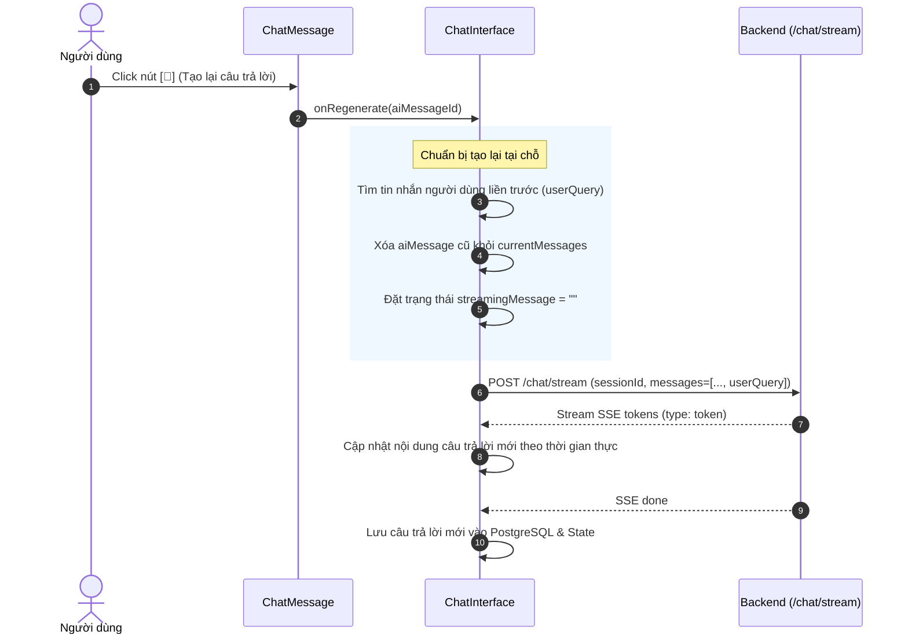

# Design: Chat Actions Refinement & True Answer Regeneration

## 1. Overview & Architectural Goals

Thiết kế này chuyển đổi cụm công cụ dưới chân tin nhắn của VietLaw AI sang tiêu chuẩn quốc tế (học hỏi từ ChatGPT và Claude):
1. **Tối giản thị giác (Icon-only & Subtle)**: Loại bỏ các nhãn chữ chiếm diện tích, gom cụm nút thành icon nhỏ gọn (16x16px) với tooltip rõ ràng, hiệu ứng hover nhẹ nhàng.
2. **Cơ chế True Regeneration (Sinh lại tại chỗ)**: Tách biệt hoàn toàn tính năng *"Hỏi tiếp"* với tính năng *"Tạo lại câu trả lời"*. Khi người dùng bấm nút Regenerate, hệ thống gọi lại RAG pipeline cho câu hỏi của lượt đó và cập nhật câu trả lời mới tại chỗ.
3. **Thao tác nhanh trên câu hỏi người dùng (Prompt Editing)**: Cung cấp nút sửa nhanh câu hỏi để nạp lại vào khung chat mà không cần copy thủ công.

---

## 2. Giao diện Thanh Công cụ (UI Component Design)

### 2.1 Cấu trúc Thanh Công cụ ở Chân Câu trả lời AI (`ChatMessage.tsx`)

```
┌────────────────────────────────────────────────────────────────────────┐
│  [Logo AI]  Căn cứ theo Điều 45 Luật Đất đai 2024, người sử dụng...   │
│                                                                        │
│  10:45 AM   [📋]   [🔄]   │   [👍]   [👎]                              │
└────────────────────────────────────────────────────────────────────────┘
```

* **Timestamp:** Hiển thị giờ gửi tin nhắn dạng chữ nhỏ màu xám nhạt (`text-[11px] text-gray-400 font-medium`).
* **Nút Sao chép (`<Copy>` / `<Check>`):**
  - Hover tooltip: *"Sao chép câu trả lời"*.
  - Khi click: Copy text vào Clipboard, chuyển icon sang `<Check className="text-emerald-500" />` và tooltip thành *"Đã chép!"* trong 2 giây.
* **Nút Tạo lại câu trả lời (`<RotateCcw>`):**
  - Hover tooltip: *"Tạo lại câu trả lời"* (Regenerate).
  - Khi click: Kích hoạt callback `onRegenerate(message.id)`.
  - Nếu tin nhắn đang stream hoặc đang loading: Disable nút để tránh xung đột.
* **Phân cách:** Thanh dọc mảnh `w-px h-3.5 bg-gray-200 dark:bg-white/10 mx-1`.
* **Nút Đánh giá Thumbs Up (`<ThumbsUp>`):**
  - Hover tooltip: *"Câu trả lời hữu ích"*.
  - Active: Màu xanh lá `text-emerald-500`.
* **Nút Đánh giá Thumbs Down (`<ThumbsDown>`):**
  - Hover tooltip: *"Báo cáo câu trả lời chưa chuẩn"*.
  - Active: Màu đỏ `text-red-400`, hiển thị Popover đánh giá lý do và góp ý.

### 2.2 Cấu trúc Thanh Công cụ ở Tin nhắn Người dùng

```
┌────────────────────────────────────────────────────────────────────────┐
│                                 [Điều kiện mua bán đất là gì?]  [User] │
│                                                                        │
│                                               10:44 AM   [📋]   [✏️]    │
└────────────────────────────────────────────────────────────────────────┘
```
* **Nút Sao chép (`<Copy>`):** Sao chép nhanh câu hỏi của chính mình.
* **Nút Sửa câu hỏi (`<Pencil>`):** Đưa câu hỏi vào ô input và focus con trỏ để người dùng sửa lại nội dung.

---

## 3. Luồng Xử Lý Cơ Chế True Regenerate

### 3.1 Trình tự Thực Thi (Sequence Flow)



### 3.2 Xử lý Dữ liệu trong State & PostgreSQL
* **Tại Frontend (`ChatInterface.tsx`):**
  - Hàm `handleRegenerate(messageId: string)`:
    1. Xác định vị trí của tin nhắn AI: `aiIndex = currentMessages.findIndex(m => m.id === messageId)`.
    2. Tìm tin nhắn người dùng gần nhất phía trước: `userMsg = currentMessages.slice(0, aiIndex).reverse().find(m => m.role === 'user')`.
    3. Cắt danh sách tin nhắn để loại bỏ câu trả lời cũ: `truncatedMessages = currentMessages.filter(m => m.id !== messageId)`.
    4. Kích hoạt lại luồng sinh tin nhắn với câu hỏi `userMsg.content` và lịch sử trước đó.
* **Tại Backend & Cơ sở dữ liệu:**
  - Không phát sinh thêm tin nhắn người dùng mới trong DB.
  - Lượt lưu mới sẽ cập nhật bản ghi tin nhắn của Assistant cho phiên hội thoại đó.

---

## 4. Bảng Đối Chiếu Thay Đổi Mã Nguồn

| File | Thành phần | Thay đổi cụ thể |
| :--- | :--- | :--- |
| `frontend/components/chat/ChatMessage.tsx` | UI Toolbar | Chuyển đổi toàn bộ nút sang Icon-only, thêm tooltip chuẩn, hỗ trợ `onRegenerate` và `onEditPrompt`. |
| `frontend/components/chat/ChatInterface.tsx` | Handlers | Triển khai `handleRegenerate` và `handleEditPrompt`, truyền xuống `ChatMessage`. |
| `frontend/scripts/verify-chat-ux.mjs` | Test Script | Cập nhật kịch bản kiểm thử giao diện để xác nhận các icon button và thuộc tính tooltip. |
