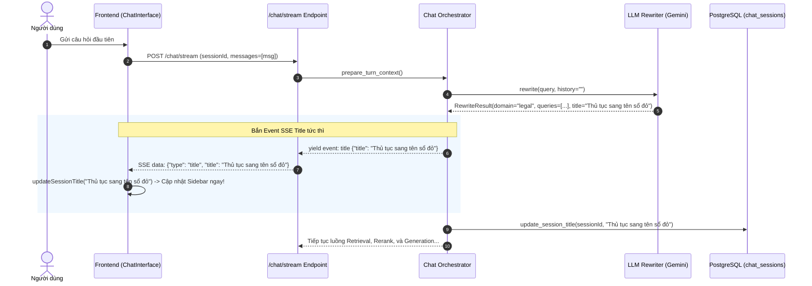

# Design: RAG Pipeline Refinements and Test Suite Cleanup

## 1. Overview & Architectural Goals

Bản thiết kế này tập trung vào 4 mục tiêu nâng cao chất lượng trải nghiệm người dùng, độ chính xác của ngữ cảnh pháp lý và tính tinh gọn của hệ thống kiểm thử:

1. **Smart Title Generation**: Tận dụng triệt để bước phân tích câu hỏi của `LLMRewriter` để tự động sinh tiêu đề tiếng Việt chuẩn mực, súc tích (3-6 từ) ở lượt đầu tiên; phát tán sự kiện tức thì qua SSE về Frontend và cập nhật cơ sở dữ liệu PostgreSQL.
2. **Tail Chunk Token Pruning (Cắt tỉa đuôi điểm thấp)**: Loại bỏ hoàn toàn cơ chế nén `build_compact` vốn tước bỏ các điều luật dẫn chiếu chéo C1, C2; thay bằng thuật toán cắt tỉa ưu tiên thứ hạng: giữ nguyên vẹn cấu trúc nested context của các tài liệu Top đầu và loại bỏ dần các tài liệu ở cuối danh sách xếp hạng ($doc_k, doc_{k-1}, \dots$) khi vượt ngân sách token.
3. **Fixed Top 20 Candidates**: Chuẩn hóa cố định lấy Top 20 ứng viên từ tầng Hybrid Search (`RETRIEVER_CANDIDATE_K = 20`) để đảm bảo độ phủ (Recall) trước khi đưa vào Cross-Encoder Reranker.
4. **Aggressive Test Suite Cleanup**: Xóa bỏ hoàn toàn 12 file test legacy/mồ côi/rườm rà, cô đọng thành 5 file test cốt lõi sạch sẽ, tập trung bảo vệ các luồng tính năng thực tế.

---

## 2. Smart Title Generation via LLM Rewriter

### 2.1 Mở rộng Schema Pydantic `RewriteResult`
Trong [backend/app/services/rewriting/base.py](file:///Users/cyhapun/Documents/Vietnam-Legal-QA-System/backend/app/services/rewriting/base.py):

```python
class RewriteResult(BaseModel):
    domain: str = Field(description="Domain of the query, either 'legal' or 'chitchat'")
    queries: List[str] = Field(description="List of search queries. Empty if domain is chitchat.")
    title: Optional[str] = Field(default=None, description="Concise Vietnamese title for the chat session (3-6 words) if first turn. None otherwise.")
```

### 2.2 System Prompt & Prompt Template
Trong [backend/app/services/rewriting/llm_rewriter.py](file:///Users/cyhapun/Documents/Vietnam-Legal-QA-System/backend/app/services/rewriting/llm_rewriter.py):
Cập nhật prompt chỉ dẫn:
```text
1. Determine if the query is 'legal' or 'chitchat'.
2. Read the Conversation History (if provided) to understand context. Rewrite query into formal Vietnamese.
3. Translate informal terms/slang into formal legal terminology.
4. Provide formal standalone translation, and optionally 1-2 decomposed sub-queries.
5. IF Conversation History is empty or this is the first turn, generate a concise Vietnamese title (3-6 words) summarizing the core topic (e.g. "Điều kiện chuyển nhượng đất", "Mức phạt vi phạm nồng độ cồn"). IF NOT the first turn, title MUST be null.

Strict JSON format:
{
  "domain": "legal" | "chitchat",
  "queries": ["..."],
  "title": "Tiêu đề tiếng Việt ngắn gọn" | null
}
```

### 2.3 Điều phối dữ liệu tại `chat_orchestrator.py`
Hàm `rewrite_query` được chuẩn hóa để tương thích ngược 100%:
- Nhận kết quả từ `rewriter.rewrite(query, history)`: Trả về `(domain, queries, title)`.
- Xác định lượt đầu: Khi `len(request.messages) <= 1` hoặc `recent_history_str` rỗng.
- Lưu trữ tiêu đề:
  - Nếu `title` được sinh ra, gán vào `PreparedTurnContext.session_title`.
  - Nếu là lượt sau (title là `None`), giữ nguyên `request.sessionTitle` hoặc tiêu đề hiện tại từ DB.

### 2.4 Luồng truyền thông điệp (Event & Persistence Flow)



### 2.5 Cập nhật Frontend (`ChatInterface.tsx`)
Bổ sung nhánh xử lý trong vòng lặp đọc SSE:
```typescript
else if (event.type === 'title' && event.title) {
  updateSessionTitle(event.title);
}
```
Và trong xử lý Non-Streaming:
```typescript
if (data.sessionTitle) {
  updateSessionTitle(data.sessionTitle);
}
```

---

## 3. Tail Chunk Token Pruning (Cắt tỉa đuôi điểm thấp)

### 3.1 Vấn đề của phương án cũ (`build_compact`)
Khi ngữ cảnh của Top $k$ tài liệu vượt quá ngân sách token `CONTEXT_TOKEN_BUDGET` (ví dụ 6.000 tokens):
- Cơ chế cũ gọi `build_compact(docs)`: Loại bỏ các điều khoản dẫn chiếu chéo (Cấp 1, Cấp 2) của **toàn bộ tài liệu** (kể cả tài liệu Rank 1 quan trọng nhất).
- Hậu quả: Mô hình bị mất các thông tin định nghĩa, ngoại lệ hoặc điều khoản viện dẫn then chốt của căn cứ sát nhất.

### 3.2 Thuật toán Tail Document Pruning
Tài liệu sau bước Cross-Encoder Reranker đã được sắp xếp giảm dần theo mức độ phù hợp:
$$Docs = [doc_0, doc_1, \dots, doc_{n-1}] \quad \text{với } Score(doc_0) \ge Score(doc_1) \ge \dots \ge Score(doc_{n-1})$$

Quy trình cắt tỉa:
1. Ban đầu: $SelectedDocs = [doc_0, doc_1, \dots, doc_{n-1}]$.
2. Sinh bối cảnh hoàn chỉnh (Nested Context) với $SelectedDocs$.
3. Ước lượng số token: $Tokens = \max\left(1, \lfloor \frac{\text{length}(Context) + 3}{4} \rfloor\right)$.
4. Nếu $Tokens \le TokenBudget$: Giữ nguyên toàn bộ $SelectedDocs$ và trả về.
5. Nếu $Tokens > TokenBudget$:
   - Lặp lại việc **loại bỏ tài liệu cuối cùng (Rank thấp nhất)**: $SelectedDocs.pop()$.
   - Tính toán lại bối cảnh với tập tài liệu đã giảm bớt.
   - Dừng lại khi $Tokens \le TokenBudget$ hoặc khi danh sách chỉ còn 1 tài liệu duy nhất ($SelectedDocs = [doc_0]$).

```python
def _build_context_with_budget(
    self,
    docs: List[Document],
    token_budget: Optional[int],
) -> Tuple[List[Document], str]:
    if not docs or token_budget is None:
        return docs, self.context_builder.build(docs)

    selected = list(docs)
    while len(selected) > 1:
        context = self.context_builder.build(selected)
        estimated_tokens = max(1, (len(context) + 3) // 4)
        if estimated_tokens <= token_budget:
            logger.info("Context budget %d tokens kept %d/%d documents (estimated=%d)", token_budget, len(selected), len(docs), estimated_tokens)
            return selected, context
        # Loại bỏ chunk ở đuôi (điểm xếp hạng thấp nhất)
        dropped = selected.pop()
        logger.info("Context budget exceeded (%d > %d), dropping lowest-ranked chunk: %s", estimated_tokens, token_budget, dropped.metadata.get("id"))

    context = self.context_builder.build(selected)
    return selected, context
```

---

## 4. Cố định Top 20 Candidates (`RETRIEVER_CANDIDATE_K = 20`)

### 4.1 Cấu hình đồng bộ
- `.env` & `.env.example`: `RETRIEVER_CANDIDATE_K=20`
- `backend/app/config.py`: `RETRIEVER_CANDIDATE_K = int(os.getenv("RETRIEVER_CANDIDATE_K", "20"))`
- `pipeline.py`: Tham số mặc định `k: int = RETRIEVER_CANDIDATE_K` (tương đương 20).

### 4.2 Phễu lọc dữ liệu (Funnel)
- **Tầng 1 (Hybrid Search)**: Thu thập Top 20 ứng viên từ sự kết hợp của Dense Vector (BGE-M3 1024d) và Sparse Lexical (BM25) qua thuật toán RRF.
- **Tầng 2 (Cross-Encoder Reranking)**: Chấm điểm tương tác chéo giữa câu hỏi và 20 ứng viên, xếp hạng lại từ cao xuống thấp và cắt lấy Top 5 (`RETRIEVER_K = 5`).
- **Tầng 3 (Nested Context & Tail Pruning)**: Kéo dẫn chiếu chéo C1, C2 cho Top 5, nếu vượt budget token thì loại bỏ dần từ Rank 5 trở đi.

---

## 5. Aggressive Test Suite Cleanup

### 5.1 Danh sách 12 file test bị xóa bỏ hoàn toàn
1. `backend/tests/test_local_models_real.py`: Yêu cầu file weight local ở `../models/...`.
2. `backend/tests/test_local_model_config_validation.py`: Kiểm tra tham số vụn vặt.
3. `backend/tests/test_qdrant_faiss_fallback.py`: 22 test mock FAISS fallback đã bị loại bỏ khỏi kiến trúc.
4. `backend/tests/test_legal_quality_evaluation.py` & `backend/tests/fixtures/`: Kiểm tra script đánh giá offline.
5. `backend/tests/test_pipeline_timing.py`: 15 test đo đạc collector nội bộ quá chi tiết.
6. `backend/tests/test_deployment_runtime_profiles.py`: 14 test kiểm tra browser storage mode và file text requirements.txt.
7. `backend/tests/test_local_embedding_runtime.py`: Test mock embedding local cũ.
8. `backend/tests/test_local_reranker_runtime.py`: Test mock reranker local cũ.
9. `backend/tests/test_pipeline_lazy_init.py`: Kiểm tra lazy import dư thừa.
10. `backend/tests/test_pipeline_reranker_runtime.py`: Thay thế hoàn toàn bởi `test_pipeline.py`.
11. `backend/tests/test_storage_schema_bootstrap.py`: Gộp kiểm tra.
12. `backend/tests/test_storage_dimension_config.py`: Gộp kiểm tra.

### 5.2 Danh sách 5 file test cốt lõi được xây dựng & giữ lại

1. **`backend/tests/test_pipeline.py`** (~80 lines):
   - Kiểm thử Rewriter sinh `title` ở lượt đầu tiên và trả về `None` khi có history.
   - Kiểm thử tầng Retrieval mặc định với `candidate_k = 20`.
   - Kiểm thử Cross-Encoder Reranker chọn Top 5.
   - Kiểm thử Tail Chunk Pruning: Khi ngữ cảnh vượt budget, chunk Rank thấp nhất bị loại bỏ, chunk Rank 1 giữ nguyên.
2. **`backend/tests/test_llm_google_fallback.py`** (~100 lines):
   - Kiểm thử luân chuyển Key khi gặp HTTP 429 trên Google AI Studio.
   - Kiểm thử luân chuyển Model dự phòng khi gặp HTTP 503.
3. **`backend/tests/test_answer_validation.py`** (~70 lines):
   - Kiểm thử bóc tách thẻ trích dẫn `<cite id="...">`.
   - Kiểm thử loại bỏ ID trích dẫn giả mạo (hallucinated citations).
   - Kiểm thử fallback an toàn khi không có căn cứ hợp lệ.
4. **`backend/tests/test_chat_api.py`** (~120 lines):
   - Kiểm thử non-streaming `/chat`: Trả về `sessionTitle`, `text`, `contextUsed`.
   - Kiểm thử streaming `/chat/stream`: Bắn đầy đủ các sự kiện SSE `title`, `context`, `token`, `done`.
   - Kiểm thử lưu trữ phiên chat vào PostgreSQL.
5. **`backend/tests/test_health_readiness.py`** (~50 lines):
   - Kiểm thử endpoint `/health` (nhanh, không phụ thuộc).
   - Kiểm thử endpoint `/ready` (xác thực tính sẵn sàng của hệ thống).
